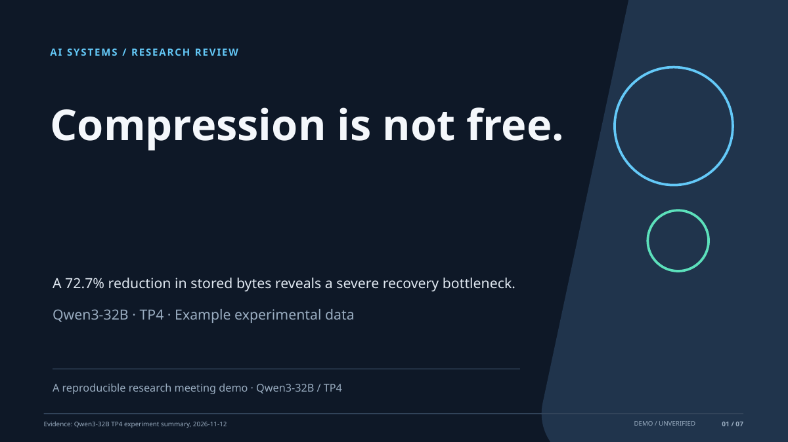

# AIAutoSlides Making 🎬

**Evidence-first · AI-assisted · Editable PowerPoint · Reproducible research talks**

> A small, runnable starter project for turning a research brief or a verified storyboard into an editable `.pptx` deck. It prioritizes **scientific accuracy and reproducibility** over one-click visual spectacle.
>
> 中文说明为主；命令和配置兼容 Windows PowerShell、macOS 和 Linux。**No API key is required for the local demo.**



## ✨ What it does today (MVP v0.1.0)

| Capability | Status | Notes |
|---|---|---|
| JSON storyboard → editable PPTX | ✅ Implemented | PptxGenJS native text, shapes and chart objects |
| Seven-slide research example | ✅ Implemented | Covers research findings, metrics, chart, process, next steps |
| Three selectable themes | ✅ Implemented | `academic-light`, `tech-dark`, `keynote-minimal` |
| Evidence ledger and structural validation | ✅ Implemented | Rejects unknown evidence IDs and malformed numerical charts |
| Optional AI storyboard via Responses API | 🟡 Implemented, requires your key | Requires network/API access; not tested against a live account here |
| GitHub Actions unit checks / PPTX artifact | 🟡 Workflow included | Must validate after first push to your own GitHub repository |
| Local PDF/PNG preview | 🟡 Optional | Requires LibreOffice; PNG also needs Poppler (`pdftoppm`) |
| PDF input / automatic chart extraction | ⏳ Not in MVP | Convert/curate evidence into Markdown/JSON manually |
| Visual overflow auto-detection | ⏳ Future work | Current validation checks structure, *not* rendered pixel geometry |
| Multi-agent design critic | ⏳ Future work | Use the included Codex task brief |

**Important:** The demonstration experimental numbers were provided in the research discussion and have not been independently verified against original experiment logs. They are tagged as unverified in `sources/evidence.json`. Do not publish the example as a scientific conclusion without checking them.

## 1. Quick start (Windows PowerShell)

**Prerequisites:** [Node.js](https://nodejs.org/en/download) **20+**, npm, and optionally [Git](https://git-scm.com/downloads). PowerPoint is needed only to edit/open the exported deck, not to generate it.

```powershell
# Download/unzip the project, then open PowerShell in its root
cd AIAutoSlides
node --version
npm install
npm run test
npm run validate
npm run build
```

Open `outputs/research-demo.pptx` in Microsoft PowerPoint. The accompanying `outputs/research-demo.review.json` reports unresolved evidence warnings. **No API charge for the commands above.**

If an existing PPTX viewer cannot display the generated chart correctly, open it in PowerPoint and inspect the chart separately. Do not substitute a screenshot without documenting the loss of editability.

### macOS / Linux

```bash
cd AIAutoSlides
node --version
npm install
npm run check
```

This generates `outputs/research-demo.pptx`. No Docker, GPU, or Python required for the core project.

## 2. Generate a different theme

```bash
node src/cli.mjs build \
  --input examples/research-demo.json \
  --theme academic-light \
  --out outputs/research-light.pptx
```

Available themes are in `themes/*.json` and can be extended without changing source code. For a high-contrast visual style, try `--theme tech-dark`.

## 3. Build your own research slides (without any AI service)

1. Copy `examples/research-demo.json` to `content/my-talk.json` and update `meta`, slide titles, body, metrics, chart data, and notes.
2. Add citations to `sources/evidence.json`; give each evidence entry a stable ID such as `E3`, a source/locator, and the verification status.
3. For factual slides, include those IDs under `evidence_ids`. Numerical charts and metrics **must** include an evidence ID.
4. Build and check:

```bash
node src/cli.mjs validate --input content/my-talk.json
node src/cli.mjs build --input content/my-talk.json --out outputs/my-talk.pptx
```

Supported slide types: `cover`, `statement`, `metrics`, `chart` (native bar chart), `process`, `bullets`, `closing`. See `docs/SCHEMA.md` for exact examples.

> The numerical values in charts must come from the evidence source, not from text-to-image or AI extrapolation. Validation currently checks that they are numeric and referenced, **not** that they match original experiments. Human verification remains mandatory.

## 4. Let AI create a storyboard (optional)

The optional `plan:ai` command uses the [OpenAI Responses API](https://developers.openai.com/api/reference/resources/responses/methods/create) with [Structured Outputs](https://developers.openai.com/api/docs/guides/structured-outputs). It generates only narrative slide types to reduce the risk of fabricated numerical charts. It **never generates empirical chart values**.

**Setup:** An OpenAI API key is separate from a ChatGPT subscription and usage may incur API charges. You can also skip this integration entirely and ask Codex to edit `content/my-talk.json` interactively.

```powershell
Copy-Item .env.example .env
notepad .env
# Set OPENAI_API_KEY=... and, if desired, OPENAI_MODEL=...
npm run plan:ai
node src/cli.mjs validate --input content/ai-storyboard.json
node src/cli.mjs build --input content/ai-storyboard.json --theme academic-light --out outputs/ai-first-draft.pptx
```

Default model in `.env.example` is `gpt-6-luna`, as listed in the [current API model catalog](https://developers.openai.com/api/docs/models); if your account lacks access, select another model available to your account. The script reads your **local** `sources/brief.md` and `sources/evidence.json`, sends their contents to the configured API, then saves the structured output locally. **Do not submit confidential/unpublished research to a third-party or cloud API unless authorized.** Never commit `.env` or keys.

If the API returns a schema error, review the response error and rerun after correcting your account/model configuration. **This API path was not live-tested in the build environment.**

## 5. Preview and visually QA the deck

Install [LibreOffice](https://www.libreoffice.org/download/download-libreoffice/) for PPTX → PDF; install [Poppler](https://poppler.freedesktop.org/) for optional PDF → PNG.

```bash
npm run preview
# or:
node scripts/preview.mjs outputs/my-talk.pptx
```

Windows users may need to add LibreOffice's `program` directory to `PATH`. On systems without LibreOffice, open the `.pptx` in PowerPoint, use Export → PDF, and review every page.

**Human QA gate:** (1) read all titles as a single story; (2) verify numbers against original files; (3) inspect chart axes and legends; (4) check text overflow and font substitution; (5) verify slides are editable in PowerPoint; (6) run a rehearsal at the actual projection resolution. The automatic validator cannot replace this step.

## 6. Work with Codex

Install [Codex CLI](https://github.com/openai/codex) and sign in with your supported account. Windows installation can use:

```powershell
npm install -g @openai/codex
codex
```

For Codex on Windows, Microsoft and OpenAI documentation may recommend different environments depending on the CLI release; follow the official [Codex setup guide](https://learn.chatgpt.com/docs/codex/cli).

The repo includes [`AGENTS.md`](AGENTS.md), which Codex reads as project instructions, plus a task-specific prompt in [`docs/CODEX_TASK.md`](docs/CODEX_TASK.md). Start Codex **inside the repository folder** and paste the task:

```powershell
cd AIAutoSlides
codex
# In Codex chat: Read AGENTS.md and docs/CODEX_TASK.md. Execute Phase 1, run all tests, and report evidence.
```

Codex may need your permission to install npm dependencies, open external documents, or alter the workspace. Keep approval prompts enabled for untrusted commands.

## 7. Publish to GitHub

This archive is a **local starter repository**, not yet a live remote repository. Create an empty repo named `AIAutoSlides-Making` on [GitHub](https://github.com/new) (do **not** pre-initialize README/LICENSE/gitignore), then run:

```bash
git init
git add .
git commit -m "Initial evidence-first slides engine"
git branch -M main
git remote add origin https://github.com/YOUR_GITHUB_USERNAME/AIAutoSlides-Making.git
git push -u origin main
```

The included `.github/workflows/ci.yml` runs validation/tests/build and saves a PPTX artifact. On the first online `npm install`, commit the generated `package-lock.json` for more deterministic dependency installs, then prefer `npm ci` in CI. Check Actions run results rather than assuming the workflow passed.

## 8. Project layout

```text
AIAutoSlides/
├── AGENTS.md                   # Codex working rules
├── README.md                   # Setup + workflows
├── src/
│   ├── ai-plan.mjs             # optional AI storyboard
│   ├── cli.mjs                 # validate / build
│   ├── render.mjs              # editable PPTX layouts
│   └── validate.mjs            # source and schema checks
├── sources/
│   ├── brief.md                # natural-language source brief
│   └── evidence.json           # evidence ledger
├── examples/research-demo.json # curated 7-slide example
├── themes/*.json               # style tokens
├── docs/
│   ├── CODEX_TASK.md           # next Codex implementation tasks
│   ├── SCHEMA.md               # storyboard reference
│   ├── REFERENCES.md           # research and docs links
│   └── demo-cover.png          # screenshot from example deck
├── scripts/preview.mjs         # optional LibreOffice conversion
├── tests/validate.test.mjs     # built-in Node test suite
└── .github/workflows/ci.yml    # CI
```

## 9. Design philosophy

- **Assertion–Evidence:** every substantive slide starts with the claim, then shows supporting evidence ([MIT EECS](https://mitcommlab.mit.edu/eecs/commkit/slideshow/), [Michael Alley/Penn State](https://www.writing.engr.psu.edu/speaking.html)).
- **Narrative before cosmetics:** plan audience, decision, story arc, and slide sequence before choosing visuals ([Apple WWDC](https://developer.apple.com/videos/play/wwdc2018/811/), [YC](https://www.ycombinator.com/blog/how-to-design-a-better-pitch-deck)).
- **Real source → real chart:** editable chart data from curated measurements, not illustration generated by a text/image model.
- **Two delivery modes (future):** short **Talk Deck** and detailed **Reading Deck** generated from one evidence ledger.
- **Repeatable builds:** source files tracked with Git, tests and rendering review performed on every change.

See [`docs/REFERENCES.md`](docs/REFERENCES.md) for universities, financial firms, Silicon Valley, professional associations, open-source tools, and community examples.

## 10. MVP boundaries and roadmap

This is an engineered starter, not a finished slide-design SaaS. Priorities for Codex:

1. Add true rendered-slide clipping/contrast detection and visual regression tests.
2. Add line/scatter/CDF charts, CSV ingestion and provenance-aware figure compilation.
3. Add optional source-file extraction for Markdown/PDF/DOCX without silently losing citations.
4. Add a visual-critic evaluation with deterministic rubrics, comparing native editable PPTX versus HTML approaches.
5. Support Talk Deck and Reading Deck outputs with the same content graph.

These follow-up tasks are detailed in [`docs/CODEX_TASK.md`](docs/CODEX_TASK.md).

## License

MIT — see [`LICENSE`](LICENSE). Sources and third-party examples linked in the documentation remain owned by their respective authors. This repository does not redistribute third-party slide templates or proprietary designs.
