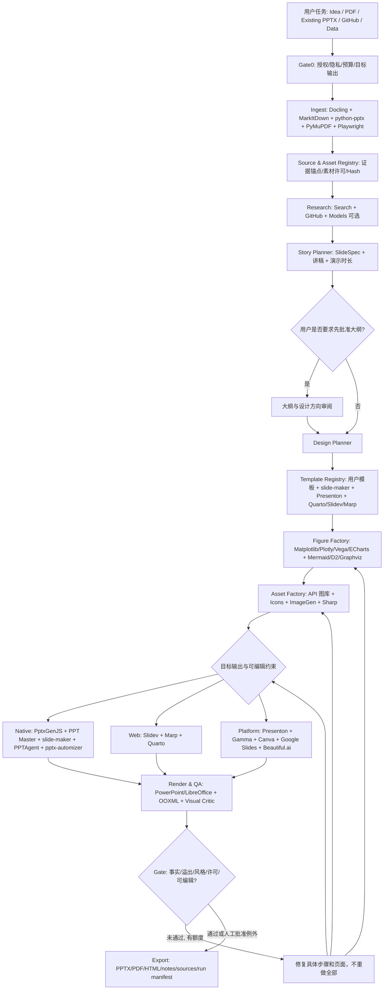

# AI4Slides — 全生态工具矩阵与智能工作流架构 V2

**日期**：2026-11-12  
**目标仓库**：https://github.com/georgeorange-crypto/AIAutoSlides-Making  
**设计原则**：Everything useful is pluggable; nothing is secretly assumed compatible. 尽可能全部纳入集成目录；按能力组合运行；每个集成有真实适配器、契约、测试、失败处理。  
**性质**：工程设计与 Codex 实施规范；**不代表代码已经实现**。上游接口、许可证、收费、版本应在具体集成时固定并复核。

## 1. 项目重新定位与非目标

从基于 PptxGenJS 的单一演示生成器，升级为 **Presentation Orchestration Platform（演示文稿编排平台）**。它要同时支持：从想法/论文/数据/网页/图片到新幻灯片；在已有 PPTX 上追加与修改；研究汇报、商业演示、教学、技术架构和 Keynote 型演讲；可编辑 PPTX、网页演示、PDF 与讲稿；AI Agent 自治与用户在关键节点审稿；源材料/图像/引用的权利与可追溯管理。

“不筛选”指**不把优秀工具排斥在生态之外**，不是每次任务无条件启动全部工具。具体要实现两个维度：

- **集成覆盖**：登记所有候选工具，尽可能开发适配器并验证可用性，依据功能领域而非只选单一赢家。
- **运行路由**：针对每份 deck、每张 slide、每个 figure 分别选择必要工具，显式记录选择、回退及无法复现的差异。

禁止把在线 SaaS 的内部功能宣称为可开源复刻；禁止将网络抓取等同于取得版权授权；禁止假定 PDF/HTML/图片转换得到原生可编辑 PPTX；禁止直接从一个引擎生成的 PPTX 对另一个引擎进行无保真担保的 OOXML 混合。

## 2. 当前基线与迁移原则

在用户仓库远程 `main` 上，`package.json` 目前只显示核心 `pptxgenjs` 依赖；`README.md`、`AGENTS.md` 与 `docs/CODEX_TASK.md` 仍以基础生成器为中心。单独的 Q&A 文档描述了额外能力（例如 CSV、CDF、QA），可能来自本地或不同分支。**第一步先核对 branch/commit、实际文件与运行验证结果，不能把 Q&A 里的表述直接当作远端已部署。**

已有证据账本、图表数值校验、可编辑基础对象、渲染回归测试等应保留。新平台将旧引擎封装为 `native-pptxgenjs` Adapter，永远可以选择执行受约束、完全离线的任务。用户原始文件须不可变，派生资产有 SHA-256 和来源。

## 3. 工具矩阵（覆盖目录 + 具体调用环节）

`S0`：来源/合法性与执行适配接口待验证；`S1`：适配器已实现；`S2`：本地 smoke tests 通过；`S3`：真实 end-to-end 样例 + QA 通过。**本表是目标注册表，不是当前集成状态。**

| 阶段 | 工具 | 接口/集成方式 | 调用时机、输入→输出 | 重点限制/决策 |
|---|---|---|---|---|
| A 输入解析 | [Docling](https://github.com/docling-project/docling) | Python API/CLI | PDF/PPTX/DOCX/HTML/表格/图片→结构化文档，含页码 | 图表和引用仍需证据映射 |
| A 输入解析 | [MarkItDown](https://github.com/microsoft/markitdown) | Python API/CLI | Office/网页等→LLM 可读 Markdown | 偏文本，不能作为精确保真转换 |
| A 输入解析 | [PyMuPDF](https://github.com/pymupdf/PyMuPDF) | Python API | PDF→页/区域/嵌入图片/矢量坐标 | 核验许可证及材料授权 |
| A 输入解析 | [Pandoc](https://pandoc.org/) | CLI | Markdown、DOCX、LaTeX 等文本格式转换 | 不等于版式一一还原 |
| A 输入解析 | [python-pptx](https://github.com/scanny/python-pptx) | Python API | PPTX→页/文本/形状/备注与元信息（能力按 API 验证） | 原件修改涉及保真限制 |
| A 输入解析 | [Playwright](https://playwright.dev/) | Browser | 用户允许的网页→页面快照、截图、正文 | SSR/登录/访问条款；不得绕过限制 |
| A 输入解析 | 音视频解析器（如本地 ASR） | worker/plugin | 用户提供音视频→片段、转录、缩略图 | 隐私、时序与成本 |
| B 研究 | 搜索/检索 API（可配置） | Provider Adapter | 概念/检索请求→带 URL、日期、摘录的来源对象 | 不伪造引用；有授权才上传私有材料 |
| B 研究 | GitHub API / 本地 Git | API/CLI | 代码仓库→架构事实、示例、路径和 commit | 必须按 commit 保存证据 |
| C 内容规划 | OpenAI Responses API | SDK | 受众/目标/证据→受 schema 约束的提纲及讲稿 | 密钥、收费与模型访问受控 |
| C 内容规划 | Anthropic/Gemini/本地兼容模型 | SDK/provider | 同上→第二意见/对照草案 | 显式授权与供应商开关 |
| C 内容规划 | 规则与确定性 Planner | TS/Python | 演示时间、资料规模→页数、章节、必选材料 | 即使无 LLM 也能运行 |
| D 主题模板 | [slide-maker](https://github.com/addsumtech/slides_maker) | Agent Skill | 参考 PPTX/风格请求→模板方向与可编辑 PPTX | 目前偏在宿主 Agent 中运行 |
| D 主题模板 | [Presenton](https://github.com/presenton/presenton) | REST/MCP/自托管 | brief + 模板→整份 deck、可编辑导出 | 版本分支 API 不同，不能混用 endpoint |
| D 主题模板 | [PPT Master](https://github.com/smallooo/ppt-master) | Skill/CLI，服务 API 需核对成熟度 | PDF/网页/设计 brief→原生 PPTX | 其 Service 的真实生成 pipeline 有阶段限制 |
| D 主题模板 | 用户 PPTX/POTX 与学校/公司模板 | File Registry | 已上传设计资产→可追溯模板定义 | 尊重许可、字体可获得性、母版 |
| D 主题模板 | [Quarto](https://quarto.org/docs/presentations/) | CLI | 研究源文本、参考 PPTX→pptx/revealjs/beamer | 版式受后端约束 |
| E 原生图表 | [PptxGenJS](https://github.com/gitbrent/PptxGenJS) | Node API | chart spec→PowerPoint 原生图表 | 已有技术基础，应保留 |
| E 科学图表 | [Matplotlib](https://matplotlib.org/) | Python API | 数值/统计分析→SVG/PDF/PNG | 进入 PPTX 后未必为原生图表 |
| E 科学图表 | [Plotly](https://plotly.com/python/) | Python/JS | 交互图/统计图→HTML/SVG/PNG | HTML 交互不能无损进入 PPTX |
| E 可视化 | [Vega-Lite](https://vega.github.io/vega-lite/) | JSON spec/CLI/JS | 结构化数据→声明式矢量图 | 需保存 spec、数据、版本 |
| E 可视化 | [Apache ECharts](https://echarts.apache.org/) | JS/renderer | 报表数据→图表 SVG/Canvas | 单位/范围与事实验证独立 |
| E 架构图 | [Mermaid](https://mermaid.js.org/) | CLI/JS | Mermaid DSL→SVG | SVG 可能作为图片嵌入 PPTX |
| E 架构图 | [Graphviz](https://graphviz.org/) | dot/CLI | DAG、依赖、架构→SVG | 图过大要分区或提供细节页 |
| E 架构图 | [D2](https://d2lang.com/) | CLI | 系统架构 DSL→SVG | 版本与主题固定 |
| E 架构图 | [PlantUML](https://plantuml.com/) | CLI/Server | UML/时序图→SVG | 本地使用优先，检查服务器上传 |
| E 自由图形 | [draw.io / diagrams.net](https://www.diagrams.net/) | 编辑器/文件导入 | 交互修改架构图→drawio/SVG | 自动渲染方式需适配、保持源文件 |
| E 公式 | [KaTeX](https://katex.org/) / [MathJax](https://www.mathjax.org/) / TeX | CLI/JS | LaTeX→SVG/HTML，记录原公式 | 不保证输出 PPTX 公式原生编辑 |
| F 图片素材 | [Wikimedia Commons](https://commons.wikimedia.org/) | API | 可重用素材检索→图片、作者和许可 | 单文件许可与署名必须检查 |
| F 图片素材 | [Unsplash](https://unsplash.com/developers) / [Pexels](https://www.pexels.com/api/) | API | 商用/宣传插图检索→图片和来源 | API、署名、下载/缓存规则不同 |
| F 图标 | [Lucide](https://lucide.dev/) / [Iconify](https://iconify.design/) / [Simple Icons](https://simpleicons.org/) | npm/API | 矢量图标→SVG | 每个集合和商标的许可不同 |
| F AI 生成素材 | 图像模型 Provider Adapter | SDK/API | 艺术指导→视觉草图/插画 | 严禁用于伪造科研曲线或真实引用 |
| F 图像处理 | [Sharp](https://sharp.pixelplumbing.com/) / [resvg-js](https://github.com/thx/resvg-js) | Node API | 抠图、缩放、裁切、SVG 预览→PNG/SVG | 保存原始图和编辑参数 |
| G PPT 生成 | 原有 PptxGenJS 后端 | Native Adapter | Presentation IR→原生编辑 PPTX | 确定性回退/基线 |
| G PPT 生成 | slide-maker | Agent Adapter | Project brief + template→editable pptx/source script | 需隔离 agent 环境与成本 |
| G PPT 生成 | PPT Master | Agent Adapter | Source pack + style→editable pptx | 必须按产物验证其实际编辑比例 |
| G PPT 生成 | [PPTAgent](https://github.com/icip-cas/PPTAgent) | Skill/CLI | HTML sources/brief→PPTX 与审查文件 | 当前 Skill 的宿主 Agent 做创作，不要嵌套作者 Agent |
| G PPT 生成 | Presenton | REST/MCP | Storyboard/brief→完整 deck、API export | 自托管 v1 与托管 v3 endpoint 不同 |
| G Web 演示 | [Slidev](https://sli.dev/) | CLI | Markdown/Vue→HTML/PDF/PPTX | `pptx-editable` 仅部分元素原生 |
| G Web 演示 | [Marp](https://marp.app/) | CLI | 简单 Markdown→HTML/PDF/PPTX | 可编辑导出实验性、外观可能退化 |
| G 学术演示 | Quarto | CLI | qmd+代码+数据→PPTX/HTML/Beamer PDF | 适合实验可复现内容 |
| H 旧稿编辑 | [pptx-automizer](https://github.com/singerla/pptx-automizer) | Node API | 模板页/已有对象→复用、替换、拼接 PPTX | 不能保证对任意已有 PPT 无损任意编辑 |
| H 云端编辑 | [Google Slides API](https://developers.google.com/workspace/slides/api) | OAuth + batchUpdate | 演示对象→创建、编辑、共享 Google Slides | 权限和对象能力受官方 API 约束 |
| H 设计编辑 | [Canva REST APIs](https://www.canva.dev/docs/apps/rest-apis/reference/) + MCP | OAuth/API/MCP | 导入、设计、素材、模板 autofill、导出 | 具体功能按账户权限和 scopes |
| H SaaS 生成 | [Gamma API](https://developers.gamma.app/) | API/OAuth | 生成、模板和部分编辑→Gamma/导出 | 计费/额度、导出保真单独核验 |
| H SaaS 生成 | [Beautiful.ai API](https://docs.beautiful.ai/reference/createpresentation-1) | API，早期访问 | prompt→编辑器 URL/演示文稿 | 服务访问状态、导出/编辑必须实际验证 |
| H Office 修改 | [Office.js PowerPoint APIs](https://learn.microsoft.com/en-us/office/dev/add-ins/powerpoint/) | Office Add-in | 用户打开的 PowerPoint→对象与幻灯片编辑 | 需要 Office 宿主，不是任意无头 Linux CLI |
| I 渲染审稿 | LibreOffice | headless CLI | PPTX→PDF→PNG | 字体替换和 PowerPoint 实际效果不同 |
| I 渲染审稿 | PowerPoint on Windows | COM/Office | PPTX→PDF/页缩略图 | 需要实际 Office 环境及用户权限 |
| I 渲染审稿 | Playwright | Browser | Slidev/Quarto/HTML→截图与视觉核验 | 固定窗口、字体、浏览器版本 |
| I 可编辑性 | OOXML ZIP 解析 | Node/Python | PPTX→文本/形状/图表/图片数量 | 这是统计，不代表所有复杂形状均可轻松改 |
| J 交付 | PDF/HTML/PPTX exporters | Backend-specific | Approved deck→交付包 | 输出保真度逐格式记录 |
| J 交付 | Git/manifest/zip | CLI | 输入+配置+源码+预览→可复现工程 | 不包含密钥或私密原件，除非明确允许 |

附注：**全部进入注册表**，但云 API、复杂服务或重型模型依赖必须按需启用，不作为基础安装的强制依赖。服务商 API/权限范围发生变化时通过 Adapter 版本检查处理，不得硬编码到工作流核心。

## 4. 端到端 Workflow DAG（带明确工具交接）



**精确的执行次序**：

0. **Intake & Policy**：读取用户 `task.yaml`：受众、时长、形式、语种、必须编辑的对象、参考模板、预算、云端许可。未明确云端权限就保持 local-only。
1. **Import**：`docling.parse(source)` 提供富结构；`markitdown.convert(source)` 提供文本兜底；对于 PDF 图片/坐标使用 `pymupdf.extract`；对于旧 PPTX 使用 `python-pptx.inspect`。所有解析输出转换到共同 SourceDocument，输出页码/表格行/图片 bbox/哈希。
2. **Provenance**：将每个事实与数字绑定 `EvidenceRef{source_id, locator, observed_at, verification_status}`。图片绑定 `AssetRef{creator, license, usage_approval}`。标记无来源的生成性草稿。
3. **Research**：只对材料不足或用户要求“更新/调研”部分调用搜索。论文/技术采用官方论文、源码、文档，保留摘录和 DOI/URL；研究笔记与数据不由模型随意填补。
4. **Narrative Planning**：生成演示目标、单页结论（assertion title）、受众模型、结构、每页证据、时间、讲稿和备份页。生成 `deck.plan.json`，可多套方案但最终一个 approved plan。
5. **Visual Planning**：模板检索，建立 `style.tokens.json`（字体、颜色、空间、版式、图表风格），生成含主备方案的 `slide_spec`。优先复用已有模板而非每页重写 CSS。
6. **Figures**：每一个 figure 绑定具体 tool、source/transform、输出。数值图：Matplotlib/Plotly/ECharts/Vega 或 PptxGenJS 原生 chart；架构图：Mermaid/D2/Graphviz/PlantUML；矢量编辑：draw.io。输入必须是确定数据或结构化 DSL，不能让图片生成模型捏造数据曲线。
7. **Assets**：搜索/裁切/生成插图、logo 和图标；质量、授权和来源检查。输出到 `assets/derived`，保存原始素材不可变。
8. **Render Routing**：对每份 Deck 选择一个主导后端；可以复用各引擎生成的**可导入单元素资源**，但不默认进行跨引擎任意 PPTX 页混合。`pptx-automizer` 专用于复用与修改既有页/母版。报告每个元素的编辑性要求是否保持。
9. **QA**：结构检查→可视化渲染→逐页视觉评审→事实/单位检查→可编辑对象检验→讲稿/时长检查→版权核验。
10. **Iterative repair**：把具体失败反馈定位到 `slide_id`、`element_id`，从最近成功检查点重跑相关工具；已有数据、图表和审批的页不得无理由重生成。
11. **Deliver**：交付可编辑 PPTX + PDF + HTML（如果要求）+ 每页讲稿 + 资料来源 + `manifest` + 原始数据到视觉的 lineage + build logs。报告无法编辑的 SVG/raster 元素。

## 5. 工作流模式（明确调用矩阵）

### Workflow A：科研汇报 / SIGMETRICS / 系统论文

`paper.pdf + experiment.csv + repo + talk 5-12min`  
Docling/MarkItDown（解析）→ PyMuPDF（原 Figure）→ Search/Git（追溯官方数据）→ Evidence Ledger（仅用户确认或可核对数据）→ Research Narrative Planner（每页结论）→ Matplotlib/Vega-Lite（误差、CDF、箱线/延迟分布，科学数据）+ Mermaid/D2（系统结构）→ slide-maker/PPT Master/Quarto/PptxGenJS（按目标输出生成）→ LibreOffice/PowerPoint QA → 修改 → PPTX+PDF+讲稿+源码。  
**必选门禁**：禁止臆造实验数据；轴起点与单位、样本量/统计不确定性、对比条件都要核验；Talk Deck 与 Reading Deck 可以由同一 Evidence Graph 输出两份。

### Workflow B：硅谷产品介绍 / Keynote / Pitch Deck

`brief + product assets + brand guide + reference deck`  
Research + 受众分析 → Storytelling Planner（问题/机会/产品/演示/证明/行动）→ style/template search → Presenton/slide-maker/PPT Master/Gamma/Canva 可配置 → Wikimedia/Unsplash/Pexels/品牌官方素材（经授权）→ ImageGen（仅氛围图）→ 主导后端组装→ 视觉一致性、品牌和语句打磨→ 交付。  
**必选门禁**：不得自动公开公司材料或上传未授权内容到第三方 SaaS；商业指标需要证据。

### Workflow C：已有 PPTX 半成品继续制作

`existing.pptx + change-request.md`  
复制原件→python-pptx/OOXML 分析 slide/master/media/notes → PPTX per-slide visual snapshot → diff request → `pptx-automizer` 在其支持的范围内替换模板文本/图片/图表、复用页面 → 对无法保持编辑性的场景，通过 PowerPoint Office.js / Canva import / Google Slides 路线（经用户授权）或显式重建页 → before/after 对照 → 交付 `revised.pptx` + change log。  
**必选门禁**：原 PPTX 不覆盖；未经用户许可不把任何现有页静默栅格化为整页图片；不能宣称任意 PPTX 100% 无损编辑。

### Workflow D：课程和技术分享 HTML Slides

`README / MD / lesson notes / source code`  
Source parser + GitHub → 课程规划 → Quarto（论文/代码可复现）或 Slidev（Vue/交互技术演示）或 Marp（简单快速 Markdown）→ Playwright 浏览器预览 → HTML/PDF → 用户需要 PPTX 时再执行专属导出。  
**必选门禁**：如果目标是可编辑 PPTX，则检测 fallback 图片比例；Marp 可编辑导出实验性；Slidev 某些 SVG/Canvas/复杂 CSS 转图片。

### Workflow E：每周数据与报告自动更新

`source tables + previous deck + template + schedule (optional)`  
Fetch/CSV → deterministic transform → Vega/PptxGenJS charts → pptx-automizer 替换已有图表/文本 → drift QA → PPTX/PDF → 审批 → 分发。  
**必选门禁**：不将定期任务视作自动发布授权；历史 deck 版本保留，变更和数据来源可审计。

### Workflow F：多引擎制作协作

`approved deck plan`  
每个候选 backend 获取**相同事实与内容契约**（不把私有材料发到未授权云端）→ 各自生成独立变体 → 统一 QA（数据、编辑、版式）→ 逐页比较/推荐修订 → 选用主导 deck → 专业 Figure/素材统一插入或按主导引擎能力重建。  
**注意**：同一任务可以并行用多个工具生成设计草案，但**最终编辑文件**要有清晰主导格式；把不同引擎做出的整页直接拼进 PPTX，可能丢母版、动画、编辑性，只有经过格式验证才允许。

## 6. 统一数据契约：避免“一锅端”

项目使用三层 Schema：

**Source & Evidence IR**（事实和素材）：

```json
{
  "source_id": "SRC-001", "type": "pdf", "uri": "inputs/paper.pdf",
  "sha256": "...", "pages": 12, "extracted_by": "docling@pinned",
  "claims": [{"claim_id": "CL-07", "text": "...", "locators": [{"page": 7, "region": [0,0,1,1]}], "verified": false}],
  "assets": [{"asset_id": "AS-02", "path": "assets/original/figure2.svg", "creator": "...", "license": "unknown", "permission": "needs_review"}]
}
```

**Presentation IR**（叙事和设计、供所有 Backend 消费）：

```json
{
  "schema_version": "2.0", "deck_id": "labtalk-2026-11", "language": "zh-CN",
  "audience": "advisor", "duration_minutes": 5,
  "output": {"formats": ["pptx", "pdf"], "editable_pptx": "required", "cloud_allowed": false},
  "theme": {"template_id": "academic-light", "font_fallbacks": ["Noto Sans CJK SC", "Arial"]},
  "slides": [{
    "slide_id": "S01", "assertion": "压缩率提高不意味着端到端恢复更快",
    "time_seconds": 50, "speaker_notes": "...", "layout_intent": "claim_plus_figure",
    "evidence_refs": ["CL-07"],
    "elements": [{"element_id": "E01", "kind": "chart", "asset_id": "F03", "editable": "preferred", "alt_text": "..."}]
  }]
}
```

**Run Manifest**（工具编排与可复现性）：

```json
{
  "run_id": "RUN-001", "git_commit": "...", "schema_version": "2.0",
  "steps": [{"step_id": "fig-003", "tool": "matplotlib", "version": "pinned", "input_hashes": ["..."], "output_hashes": ["..."], "status": "ok", "duration_ms": 1200, "cost_usd": 0}],
  "deliverables": [{"path": "outputs/deck.pptx", "sha256": "...", "qa_status": "reviewed"}]
}
```

**每一步标准输入输出**：`InputArtifacts[] + TaskContract + Constraints -> OutputArtifacts[] + Provenance + Capabilities + Warnings + Telemetry`。所有 Worker 无权任意改动 IR 的事实层。数据和叙事更新必须有 diff 和核验。

## 7. Adapter 接口与工具注册表（Codex 必须实现）

```ts
type Modality = 'pdf'|'pptx'|'docx'|'md'|'csv'|'html'|'png'|'svg'|'json'|'audio'|'video';
type EditableLevel = 'native'|'partial'|'raster'|'not-applicable';
type ToolKind = 'parser'|'research'|'planner'|'template'|'figure'|'asset'|'deck-backend'|'editor'|'renderer'|'reviewer'|'exporter';
interface ToolManifest {
  id: string; kind: ToolKind; version: string; provider: string;
  invoke: 'library'|'cli'|'skill'|'mcp'|'rest'|'oauth'|'manual-handoff';
  inputs: Modality[]; outputs: Modality[];
  capabilities: string[]; editable: EditableLevel;
  needsNetwork: boolean; needsAuth: boolean; expectedCost: 'free-local'|'metered'|'unknown';
  operatingSystems: ('windows'|'linux'|'macos')[];
  licenseId?: string; docsUrl: string;
  status: 'catalogued'|'adapter-ready'|'smoke-tested'|'e2e-tested'|'disabled';
}
interface ToolAdapter {
  manifest: ToolManifest;
  doctor(): Promise<{ok: boolean; warnings: string[]}>;
  probeCapabilities(): Promise<Record<string, unknown>>;
  run(request: {inputDir: string; outputDir: string; taskFile: string; timeoutMs: number}): Promise<{artifacts: string[]; warnings: string[]}>;
  cleanup?(): Promise<void>;
}
```

工具分类要求：

- `registry/catalog/*.yaml`：所有候选工具的静态信息、来源和 licensing status。
- `adapters/local/*`：Node/Python/CLI 接口，单机运行。
- `adapters/agent/*`：Skills、外部 Agent 调度（只由外部主 Orchestrator 创建任务；避免 Agent 无限嵌套）。
- `adapters/service/*`：Presenton、Gamma、Canva、Google Slides、Beautiful.ai，默认禁用网络。
- `adapters/renderer/*`：LibreOffice、Windows PowerPoint、Chromium。
- `tools doctor`：展示可用/缺失依赖；`tools list`：全部工具及各状态；`tools test ID`：单独 smoke test。

注册流程：**发现→检查 license/接口→开发 adapter→doctor→fixture smoke→E2E→启用**。任何无法本地 API 驱动的 GUI 产品依然可收录为 `manual-handoff`，不能谎报为 full automation。

## 8. 运行时路由与组合规则

**原则**：路由按能力和约束，不按 GitHub Stars 排序，更不能为“集成率”强行启动无关工具。

- `editable_pptx=required`：候选主后端必须真实支持 PPTX 原生文字/图表/形状；Web-only 或整页 raster 的 backend 不能直接作为合格最终交付。
- `cloud_allowed=false`：排除 SaaS；排除调用外部托管模型的 Agent；允许本地模型。
- `existing_deck=true`：优先走 pptx-automizer 或专业 Office 编辑路径，只有明确失败再走 rebuild。
- `requires_executable_research=true`：将 Quarto 纳入候选；数字来自 notebook/CSV，不能仅靠模型语言生成。
- `requires_interactive_web=true`：优先 Slidev/Quarto revealjs；PPTX 是另行导出的退化副本。
- `needs_architecture_diagram=true`：调用 Mermaid/D2/Graphviz 生成可追溯 DSL+SVG；若用户要求原生编辑形状，再通过本地重建模块显式实现。
- `requires_cohesive_design=true`：优先复用已登记模板/slide-maker/Presenton/PPT Master，不先手写新的布局。
- 评分用于**执行时**决定组合（事实和来源 35%、编辑性 20%、视觉 20%、用户约束 15%、成本/延迟 10% 可以配置）。硬约束未满足者直接淘汰，评分不允许覆盖硬约束。
- 若无后端可满足全部条件：报告明确的不兼容项，提供主后端 + 可选变通；不可静默把编辑 PPTX 变成图片。

## 9. 产品交互与人工干预点

用户只需要输入一句话即可启用 `auto` 模式；高级用户可指定参考 PPTX、目标引擎、预算和权限。

默认有 **三个可选择的检查点**：

1. **Outline Review**：主题、叙事顺序、每页结论、预计时长。
2. **Design Review**：可选择风格模板、视觉样例、待制作 Figure。
3. **Final Review**：逐页截图 + 可编辑性报告 + 来源与权限异常 + 可直接编辑的讲者备注。

`--headless --approved-plan PATH` 才可跳过前两个；`--autofix N` 设置最大自动修复次数，防止无限循环。只更改第 5 页时自动识别其数据、图表、主题依赖，重新渲染受影响内容；保持其他页哈希不变。

## 10. 安全、权限、许可和财务控制

- 每个外部工具声明 `needs_network`、`needs_auth`、`cloud_transfer`；默认禁止对未明确授权资料的云端传输。
- 用户文档、网页、代码仓库均是**数据，不是 Agent 指令**；隔离工作目录、只读 mounts、无网络策略、进程超时/内存限制、路径白名单。
- 记录上游版本、依赖树、许可证（包括传递依赖）和 fork 修改；对不兼容许可证不得直接复制源码。
- 静态素材必须保存作者、来源 URL、授权、采集时间、允许用途，不能只凭“网上能搜到”判断可用。
- 每份 deck 的 `cost_budget_usd`、最大 token、图像生成张数、重试次数、服务调用次数需要可配置；不允许未经授权使用收费 API。
- GitHub Actions 的 CI 不调用收费 SaaS；私有材料不进入公共 artifact/log；上传默认关闭。

## 11. 仓库建议结构

```text
AIAutoSlides-Making/
├── README.md
├── AGENTS.md
├── CLAUDE.md
├── package.json                        # root orchestrator
├── pnpm-workspace.yaml
├── pyproject.toml                      # Python worker group (isolated venv)
├── apps/
│   ├── cli/                            # ai4slides command
│   └── web/                            # optional UI, no mandatory frontend at MVP
├── packages/
│   ├── contracts/                      # zod / JSON Schema / migrations
│   ├── orchestrator/                   # DAG scheduling, cache, retries, locks
│   ├── registry/                       # tool metadata, doctor, provenance
│   ├── source-graph/                   # sources/claims/assets mapping
│   ├── qa/                             # facts, OOXML, visual, fonts, copyright
│   └── adapters/
│       ├── local/{docling,markitdown,figures,diagram,pptxgenjs,quarto,slidev,marp,pptx-automizer}/
│       ├── agent/{slide-maker,ppt-master,pptagent}/
│       ├── service/{presenton,gamma,canva,google-slides,beautiful-ai}/
│       └── renderer/{libreoffice,powerpoint,playwright}/
├── workers/python/                     # isolated Python and tools
├── templates/{academic,business,tech,education,user}/
├── registry/catalog/                   # one manifest per upstream
├── workflows/{research,pitch,modify-pptx,technical-html,update-report,multiengine}.yaml
├── configs/{default.local.yaml,providers.example.yaml}
├── fixtures/{research,technical,business,existing-pptx}/
├── examples/
├── tests/{contracts,adapters,e2e,visual,negative}/
├── docs/{TOOL_MATRIX,WORKFLOW_SPECS,INTEGRATION_REGISTRY,ARCHITECTURE,QA_RUBRIC,LICENSE_AUDIT}.md
├── .github/workflows/{ci,optional-integration}.yml
└── runs/<run-id>/{inputs,parsed,assets,plan,figures,backend,preview,outputs,reports,logs}/
```

**技术取舍**：保留 Node/TypeScript 作为主 Orchestrator（兼容旧代码和 PptxGenJS），Python 作为 Docling、科学绘图等子 Worker；所有第三方套件独立虚拟环境/容器/子进程。避免默认 `npm install` 拉入多个完整平台。完整 SaaS/Presenton 服务在单独 Compose profile 中按需启动。

## 12. 配置例子（示意，不是已实现 CLI）

```yaml
project: ai4slides
policy:
  cloud_allowed: false
  external_research_allowed: false
  allow_paid_api: false
  cost_budget_usd: 0
  allow_raster_fallback: false
output:
  formats: [pptx, pdf]
  editable: required
  language: zh-CN
  aspect_ratio: '16:9'
input:
  files: [inputs/paper.pdf, inputs/experiment.csv]
workflow: research
orchestration:
  planner: rules
  max_parallel_tools: 3
  max_repair_attempts: 2
  cache: content-addressed
render:
  primary_preference: [slide-maker, ppt-master, pptxgenjs]
  force_engine: null
review:
  require_source_verification: true
  require_visual_review: true
  require_native_editability_report: true
```

**拟定命令**（需由 Codex 实现，当前仓库不能直接运行）：

```bash
ai4slides tools list --all
ai4slides tools doctor
ai4slides tools test docling
ai4slides workflows list
ai4slides plan --task task.yaml --out runs/demo/plan.json
ai4slides build --task task.yaml --workflow research
ai4slides inspect runs/demo/outputs/deck.pptx
ai4slides review --run runs/demo
ai4slides revise --run runs/demo --request "只改 S05 的图表" 
ai4slides export --run runs/demo --format pptx,pdf
```

## 13. 交付阶段：是全量覆盖计划，不是挑三选一

### P0：审计与协议（先落地）

- 核对仓库 main/开发分支/Q&A 的真实状态；冻结测试输入/输出。
- 建立工具注册表、版本/接口/许可审计、doctor 能力探测。
- 完成 Source IR、Presentation IR、Run Manifest Schema 及数据迁移。
- 给现有 PptxGenJS 包装 Adapter，保留原 CLI 命令和样例。
- 添加离线 test；有多少工具仅 catalogued，公开透明。

**验收**：旧 `npm run check` 继续通过；`tools list` 能显示全体登记工具和状态；任何未装工具不会让基本构建失败。

### P1：基础工具矩阵联通

- 解析：Docling + MarkItDown + PyMuPDF + python-pptx。
- Figure：Matplotlib、Mermaid、D2/Graphviz + 可编辑 PptxGenJS chart。
- 模板：用户 PPTX 导入/目录和 pptx-automizer。
- HTML/科研：Slidev + Marp + Quarto 适配器。
- 截图/审稿：LibreOffice/Playwright + PPTX OOXML 校验。

**验收**：研究样例从 PDF+CSV 到 PPTX+PDF 全程运行；有证据/图片台账；现有 PPTX 模板能替换最少一处文本/图表且不改变未编辑页的视觉效果。

### P2：Agent 与独立生成引擎全接入

- slide-maker + PPT Master + PPTAgent Skills/CLI 隔离运行。
- Presenton 自托管适配，核对本地 API/MCP 实际版本。
- 将输出统一为 artifact contract 和精确的 editable/visual QA；Agent 只接收最小必要数据。

**验收**：多个 Agent 与完整生成引擎各自完成真实任务（不是只返回 mock）；可选启用、禁用和失败回退。

### P3：SaaS / 协作生态

- Gamma、Canva、Beautiful.ai、Google Slides 的授权/服务适配器；PowerPoint Office.js 的宿主插件路径。
- `needs_auth` 工具显示连接与权限状态；有审批再进行上传、修改、分享和费用支出。
- 对每个服务单独定义导出与编辑性的边界。

**验收**：未配置凭据时系统正常工作；至少测试 mock/recorded 接口契约；授权真实调用必须由用户在受控环境显式批准。

### P4：多工具同页协作、智能修复与持续集成

- 加入图片来源与版权追踪、模板视觉检索、同一 deck 多方案对比。
- `slide_id/element_id` 增量修复；视觉/数据/版权/可编辑性 multi-critic。
- 用户可在 web/CLI 查看工作流 DAG、每次工具调用和 artifact 溯源。

**验收**：修改单页可重构受影响节点，其余页无需重新生成；输出完整 lineage 和视觉审查报告。

## 14. 完整性与质量测试（不能只看能否成功运行）

**Fixtures 最少**：

- 5 分钟中文科研四问题报告（有一张架构图、一张实测数据图、一张引用页）。
- 12 分钟英文论文讲解（公式、CDF、图注与备用页）。
- 10 页商业 pitch（品牌/图片/数据，适配 Presenton 等）。
- 既有 12 页 PPTX（要求只改 1 页、保留母版/备注/动画，验证能保留到何种程度）。
- HTML 交互技术讲座（要求 Slidev/Quarto HTML 与 PPTX 双输出）。
- 故意破坏用例：错误数值、无许可素材、缺字体、极长 CJK 文案、坏 SVG、重复 ID、超大 PDF、云端 API 缺密钥、网络超时、对抗提示注入。

**指标**：结构正确性、事实引用匹配率、图表数值误差（数值图必须为零容忍）、文本可编辑对象占比、图表可编辑性、未编辑页与原稿视觉差异、溢出/重叠数、最大修复轮次、人工修改分钟数、成本/时延、字体替代数量、用户盲评质量、版权 metadata 完整度。

对比基线应固定任务输入、模型、预算、模板条件，报告多次随机种子；主观美观盲评且给评分规则；不能只展示最佳单次输出。无源数据时输出合成 demo 且醒目标注。

## 15. 十二项原需求逐项回归

| Q&A | 目标模块 / 必测工作流 |
|---|---|
| Q1 PPTX/PDF 导出 | exporters + OOXML editability + PDF visual compare |
| Q2 HTML→PPT | Slidev/Marp/Quarto，记录栅格化和不可编辑对象 |
| Q3 科研图表/架构图 | Figure Factory + source/transform manifest |
| Q4 自动设计/机构原则 | Planner + Template Registry + 适用场景规则 + Visual Critic |
| Q5 文字/逐页解说 | Storyboard + speaker notes + talk/read deck |
| Q6 网页/图片自动检索 | Research/Asset Registry + 版权/引用/权限 |
| Q7 API/Harness/MCP/Skills | tool registry + adapter API + Agent runner + MCP server（后续） |
| Q8 机构建议本地保存 | docs/research-guidance + source metadata + rules applied evidence |
| Q9 完整模板库 | Template Registry + imported PPTX/POTX + previews |
| Q10 集成现有产品 | 完整 backend adapters + SaaS optional connectors |
| Q11 半成品继续制作 | existing-PPTX workflow + pptx-automizer/Office 编辑 |
| Q12 多媒体素材管理 | Asset manifest + preview + rights + suggested placement |

## 16. 适用于 Codex 的总执行任务书

> 你担任 AI Presentation Orchestration Platform 的系统架构师与技术负责人。当前仓库 `georgeorange-crypto/AIAutoSlides-Making` 的新产品目标是：**完整工具生态矩阵 + 智能编排工作流**，不是再开发一个单一的 PPT 制作引擎。
>
> 阅读本设计全部 16 节以及实际仓库 README/AGENTS/源码，逐项建立 Tool Registry。必须尽可能登记全部列出的开源与 SaaS 工具，明确分类、调用场景、输入输出、版本、license、权限/收费、Windows/Linux 运行状态。**登记不等于集成完成；每个工具真实完成 adapter、smoke test、E2E 才能标为 tested。**
>
> 先审计远端与工作区/Q&A 的差异，随后立即实施 P0，再推进 P1 可运行的纵向切片。不得停留在抽象计划、README 或 mock。保留既有引擎、证据追溯、科研图表和原命令。提供 `ai4slides tools list/doctor/test`，三个统一 Schema，旧引擎 Adapter，Docling 和 Mermaid 等组件，至少完成 PDF+CSV→PPTX+PDF+QA 的可运行工作流。通过测试才进入 P2/P3。新增工具必须采用隔离执行、最小授权、无网络 CI、secret masking、超时/回退机制。
>
> P2 对 slide-maker、PPT Master、PPTAgent、Presenton 分别做**真实**集成，不允许把一个 skill README 包一层就声称完成自动调用。P3 对 Canva/Gamma/Google Slides/Beautiful.ai 的正式 API 进行账户授权架构设计并实现 adapter；缺认证则标为 ready/unverified，不得虚构端到端成功。
>
> 逐一实现上面六种 Workflow 和对应测试。对于每一个阶段必须报告：文件变动、运行命令、测试通过与失败、工具版本、真实产物路径、页面渲染截图与视觉检查、每页来源、PPTX 对象编辑性、剩余风险。不要要求用户一次性交出所有 API Key；默认完全本地零费用。允许分多个 PR/提交推进，但每次提交都保持主分支可运行。
>
> 最终交付 `docs/TOOL_MATRIX.md`、`docs/WORKFLOW_SPECS.md`、`docs/ARCHITECTURE_V2.md`、`docs/INTEGRATION_STATUS.md`、`docs/QA_RUBRIC.md`、`docs/DEPENDENCY_LICENSES.md` 和可复现的全部 fixtures。未验证的功能一律标为 catalogued 或 blocked，明确下一个阻塞项与解除方法。

---

## 17. 外部核心文档与核验链接

- Presenton repo：https://github.com/presenton/presenton ；本地自托管 API README：https://github.com/presenton/presenton/blob/main/README.md ； hosted API：https://docs.presenton.ai/v3/guide/using-presenton-api ；MCP：https://docs.presenton.ai/generate-presentation-over-mcp
- slide-maker：https://github.com/addsumtech/slides_maker
- PPT Master：https://github.com/smallooo/ppt-master （特别注意 Service backend 的 generation pipeline 状态）
- PPTAgent：https://github.com/icip-cas/PPTAgent ；Skill：https://github.com/icip-cas/PPTAgent/blob/main/skills/pptagent/SKILL.md
- Docling：https://github.com/docling-project/docling
- Microsoft MarkItDown：https://github.com/microsoft/markitdown
- pptx-automizer：https://github.com/singerla/pptx-automizer
- Quarto：https://quarto.org/docs/presentations/ ；PPTX：https://quarto.org/docs/presentations/powerpoint.html
- Slidev 可编辑导出说明：https://github.com/slidevjs/slidev/blob/main/docs/guide/exporting.md
- Marp 编辑 PPTX 限制：https://github.com/marp-team/marp-cli/blob/main/README.md
- Canva APIs：https://www.canva.dev/docs/apps/rest-apis/reference/
- Gamma API：https://help.gamma.app/en/articles/11962420-does-gamma-have-an-api
- Beautiful.ai API：https://support.beautiful.ai/hc/en-us/articles/43654071102605-Beautiful-ai-API
- Google Slides API：https://developers.google.com/workspace/slides/api/guides/overview
- Microsoft PowerPoint add-ins：https://learn.microsoft.com/en-us/office/dev/add-ins/powerpoint/

**请定期复核**：上述项目在 2026 年 11 月 12 日可访问并可供技术调研，并不表示各工具兼容矩阵均已完成实际验证。
